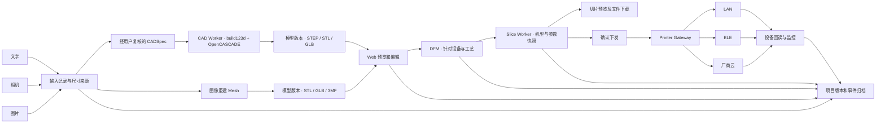

# 手机端 AI 3D 打印工作台实施架构

当前 E 盘工作台已接通本机三种输入、参数化 CAD 或轮廓网格、浏览器尺寸调整、制造检查、离线切片和历史归档。最终范围还包含三种设备连接及真机下发监控。 [本机启动与验收](../workbench/README.md)

## 数据与状态

| 对象 | 保存内容 |
|---|---|
| 项目与输入 | 通道、原始文字或资产引用、拍摄/上传时间、尺度与来源 |
| 模型版本 | 父版本、CADSpec、参数/位姿、构建器版本、几何类型、编辑能力、尺寸可信度、各产物 SHA-256 |
| DFM 报告 | 模型版本、打印机和材料版本、规则版本、阻断、警告、未验证的规则 |
| 切片任务 | 模型哈希、配置快照、工具版本、层索引、估算、切片哈希、日志 |
| 打印机和任务 | 机型、固件、授权状态、能力、切片哈希、幂等键、设备回执、状态事件 |

几何、姿态或打印工艺修改后重新检查，旧报告和切片标为失效，历史文件继续可追溯。下发前核对切片版本、目标机型配置、耗材和设备当前状态。上传和启动拥有独立回执。设备失联时标记未知并暂停发起新动作，根据设备回读恢复任务状态。归档的时间、进度和结果记录来源。

生产结构采用移动端 React、TypeScript 与 Three.js，FastAPI 暴露任务及下载接口，独立进程负责 CAD 和切片。持久化版本、任务和事件可用 PostgreSQL，后台队列可用 Redis，文件可用对象存储。第一台真机优先通过用户电脑上的局域网网关，由后端服务与设备通信。手机与该网关之间的端口、授权及 HTTPS 在目标网络实测。公网模式另外需要鉴权和局域网桥接。

G0 的建模输入只允许结构化数值驱动随项目提供的模板。模型服务接入后，优先让大模型输出经过验证的 CADSpec。若支持自定义生成脚本，执行环境必须独立，并限制网络、资源和可访问文件。

## 本机 HTTP 接口

| 方法与路径 | 作用 |
|---|---|
| POST /api/projects | 保存文字、照片或图片，排队建模、检查及切片 |
| GET /api/projects | 读取本机历史项目 |
| GET /api/projects/{id} | 读取阶段状态、模型、DFM、切片摘要和文件入口 |
| POST /api/projects/{id}/resize | 以平面比例和厚度新建版本，重跑建模、DFM 和切片 |
| POST /api/projects/{id}/rebuild | 以独立几何参数、层高或填充率重建，归档新版本及其实际使用的切片配置 |
| GET /api/projects/{id}/files/{key} | 加载和下载归档文件 |

## 扩展 HTTP 接口草案

以下路径供多用户、设备适配和服务端扩容使用。

| 方法与路径 | 契约 |
|---|---|
| POST /api/v1/models/generate | 提交输入、CADSpec 或影像，返回任务 ID |
| GET /api/v1/tasks/{id} | 查询排队、运行、成功、失败或取消及错误码 |
| POST /api/v1/tasks/{id}/cancel | 请求取消构建或切片任务 |
| POST /api/v1/models/{id}/versions | 编辑参数或位姿并构建新版本 |
| POST /api/v1/models/{id}/dfm | 根据模型、工艺和机型版本生成检查报告 |
| POST /api/v1/slices | 以当前有效 DFM 和工艺参数提交切片任务 |
| GET /api/v1/slices/{id} | 查看分层、估算与下载文件 |
| POST /api/v1/printers/bind | 验证地址、授权和真实能力 |
| POST /api/v1/print-jobs | 幂等创建并准备上传 |
| POST /api/v1/print-jobs/{id}/commands | 用户确认后调用适配器，记录回执 |
| GET /api/v1/print-jobs/{id}/events | 查询设备事件，支持断线后的补偿读取 |
| GET /api/v1/projects/{id}/history | 返回输入、版本、报告、切片和打印事件 |

## 阶段验收

| 阶段 | 可验收结果 |
|---|---|
| G0 技术探针 | STEP / STL / GLB 几何复检、实际切出 G-code、读取指定实体设备状态 |
| G1 文字到真机 | 规则零件文字建模、真实编辑与失效控制、DFM、匹配首台设备的切片、用户确认下发、实物完成及归档 |
| G2 三路输入 | 相机/相册输入、CAD 与 Mesh 路由、尺度来源、至少两种移动浏览器完成真实预览和编辑 |
| G3 工程加固 | 持久化与重试、取消、幂等、可信配置、隔离与权限、弱网和重复点击回归测试、可重现部署 |
| G4 设备扩展 | 针对具体机型验证 BLE GATT 传输、官方云授权与跨网下发、逐设备监控及控制回读 |

## 参考与许可

- Text-to-CAD 项目的本地 Agent 工作流用 build123d 函数保存可重建参数。本项目参考这条工作流，G0 的模板和校验代码独立编写。将本地工具转换为多用户服务时需要单独实现任务隔离、权限和存储。 [上游仓库](https://github.com/earthtojake/text-to-cad) · [CAD Skill](https://github.com/earthtojake/text-to-cad/blob/main/skills/cad/SKILL.md)
- build123d 0.13.0 采用 Apache-2.0，提供 STEP、STL 与 glTF 导出。三维预览单位按 glTF 规范使用米，STEP 和 STL 样件以毫米复核。 [发布元数据](https://pypi.org/project/build123d/0.13.0/) · [导出 API](https://build123d.readthedocs.io/en/stable/import_export.html) · [glTF 2.0 规范](https://registry.khronos.org/glTF/specs/2.0/glTF-2.0.html)
- 切片引擎保持为独立外部进程。部署或分发前需要核对锁定版本的许可证和源代码义务。 [OrcaSlicer CLI](https://github.com/OrcaSlicer/OrcaSlicer/wiki/cli_mode) · [OrcaSlicer 源码与许可](https://github.com/OrcaSlicer/OrcaSlicer)
- OctoPrint 和 Moonraker 有公开状态接口。浏览器访问局域网和使用 Web Bluetooth 均受浏览器权限及运行环境约束。BLE 还需目标机型的可核实 GATT 服务与打印协议。 [OctoPrint 打印机接口](https://docs.octoprint.org/en/main/api/printer.html) · [Moonraker 打印机接口](https://moonraker.readthedocs.io/en/latest/external_api/printer/) · [Chrome 本地网络访问](https://developer.chrome.com/blog/local-network-access) · [Web Bluetooth](https://developer.mozilla.org/en-US/docs/Web/API/Web_Bluetooth_API)
